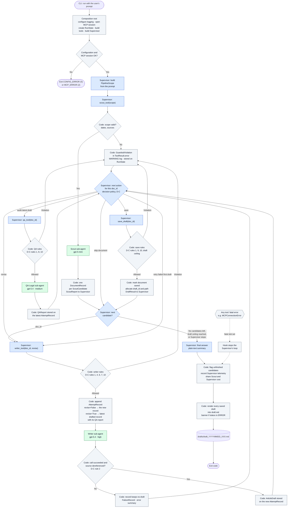

# HSE Easy — Approach 2 Specifications
## Research Analyst (Supervisor Agent-Orchestrated System)

**Status:** Approved, 2026-09-28. This file consolidates the design plan (Draft v7) with decisions P1 to P12 from `IMPLEMENTATION_PLAN.md` §2.
**SDK checked against:** `strands-agents 1.55.1`, the version locked in Approach 1's `uv.lock`.
**Approach 1 (reference project):** `../code-orchestration/`, the folder next to `agent-orchestration/`. On this machine that is `C:\Users\Saksham\Git\poc\AIAgents\code-orchestration`. It is **read-only**. Its `src/`, `tests/`, `uv.lock`, `drafts/` and `.agents/docs/` are the baseline this project reuses and is benchmarked against.

This is the single source of truth for Approach 2's architecture decisions and contracts.

| Document | Role |
| :--- | :--- |
| [`DESIGN.md`](DESIGN.md) | The concept |
| [`IMPLEMENTATION_PLAN.md`](IMPLEMENTATION_PLAN.md) | The build sequence |
| This file | The specification |

Where they disagree, this file wins, and the disagreement is a stop condition (`IMPLEMENTATION_PLAN.md` §1.4).

**Contents**

| § | Section |
| :---: | :--- |
| 1 | Goal and benchmark constants |
| 2 | What Approach 1 provides |
| 3 | Multi-agent pattern |
| 4 | Activity flow |
| 5 | Architecture decisions D-A to D-J |
| 6 | Data model |
| 7 | Interfaces: tools, views, check order, CLI, logs, exit codes |
| 8 | Decision log: Q1–Q12, DM1–DM18, P1–P12 |

---

### 1. Goal and benchmark constants

Build the same editorial product as Approach 1 — Italian/EU HSE regulatory updates turned into audited, TDI-branded draft articles — but with a different control model:

* **Approach 1, Content Factory — "Code owns the flow."** Its `src/orchestrator.py` decides sequencing, the revision counter, candidate throttling and error recovery. Agents are callable workers.
* **Approach 2, Research Analyst — "An agent owns the flow."** A Supervisor Agent receives the raw prompt, plans the run, and calls the Scout, Writer and QA sub-agents as tools. The execution path emerges at runtime.

The two approaches are benchmarked against each other, so **orchestration is the only intentional variable.** Everything else is held constant:

| Held constant | Specification |
| :--- | :--- |
| Substrate | `hse-easy-mock`, the same five tools |
| Models and efforts | Scout `gpt-5-mini`, no effort; Writer `gpt-5.4`, `high`; QA-Legal `gpt-5.4`, `medium` |
| Tool binding | **All five substrate tools attached to every sub-agent**, as in Approach 1 (its D19; P1). The `*_TOOL_NAMES` tuples remain declared intent; each prompt draws the boundary |
| Prompts | The Scout and QA-Legal system prompts are byte-identical to Approach 1's. The Writer receives the same `ScoutCandidate`, now inside an `AttemptRecord` (§6.2); its prompt is reworded only where it names that input |
| Template | `.agents/templates/draft.md`, identical to Approach 1's current template (P8) |
| Cost basis | Approach 1's three-rate cost model (D21) |
| Execution | Sequential: one sub-agent call at a time (D-H) |

#### 1.1 Division of labour

**The Supervisor supervises agents, not drafts.** Each sub-agent does its own job, as defined by its own prompt; the Supervisor only decides what happens next. It never reads, reviews or edits article text.

| Who | Does | Never does |
| :--- | :--- | :--- |
| **Supervisor** | Turns the user's prompt into a `PipelineScope` (Q12 = A); calls the Scout; decides which candidates to draft; reads each `QAReport` and decides whether to request a revision or save; decides when the run is finished | Read or judge article text; write feedback for the Writer; write Markdown |
| **Scout** (`scout_tool`) | Finds and ranks qualifying regulatory updates → `ScoutReport` | — |
| **Writer** (`writer_tool`) | Writes the `ArticleDraft`, and revises the latest one from its `AttemptRecord` | Audit its own work; write the Markdown file |
| **QA-Legal** (`qa_tool`) | Audits the latest `ArticleDraft` → `QAReport` | Change the draft; write the Markdown file |
| **Code** (tool wrappers, `RunState`) | Stores every draft and QA report; counts attempts; hands the Writer and QA-Legal their `AttemptRecord`; enforces guardrails; renders the saved drafts into Markdown at run end; logs | Make editorial or routing decisions |

---

### 2. What Approach 1 provides

#### 2.1 Reused as-is, or nearly

| Approach 1 module (`../code-orchestration/src/`) | What it gives Approach 2 |
| :--- | :--- |
| `schemas.py` | The substrate models, `ScoutCandidate`, `ScoutReport`, `ArticleDraft`, `QAReport`, `WorkerOutput`, the telemetry models, `FailureRecord`, `DraftMetadata` and the exit codes. §6 marks what is reused, amended or dropped |
| `mcp_client.py` | `HSEMockMCPClient` over stdio, with transport death classified as `MCPConnectionError` |
| `template_engine.py` | Draft ID allocation, placeholder rendering, telemetry tables |
| `costs.py` | The three-rate cost model, with the cached-input double-charge fix (D21) |
| `credentials.py`, `model_factory.py` | `.env` credentials, provider isolation, per-role reasoning effort (D24) |
| `diagnostics.py` | Full-fidelity capture of remote errors (D22) |
| `agents.py` | The Scout, Writer and QA-Legal system prompts, the runners and `extract_telemetry`. The runners are adapted to take one input model each (§6.2) |
| `configure_logging` and `_ApiKeyRedactionFilter`, in `orchestrator.py` | The dated log file, five routed loggers and API-key redaction (D22). Extracted into their own module (D-I) |
| `estimate_cost` and `amortise_shared_telemetry`, in `orchestrator.py` | Per-draft cost and the equal share of run-level telemetry. Moved into their own module |
| `tests/support/scripted.py`, `tests/conftest.py` | The scripted-model harness and environment isolation, for zero-token tests (D16) |

D-J says exactly what is copied, and which tests come with it.

#### 2.2 Replaced

* Approach 1's `orchestrator.py`, 1,481 lines of procedural control → the Supervisor Agent plus a thin CLI and composition root.
* The ScopeParser worker → absorbed by the Supervisor, which builds the `PipelineScope` itself (Q12 = A).

#### 2.3 Baseline numbers (Approach 1 drafts on disk)

| Metric | Range across 10 drafts |
| :--- | :--- |
| Cost per draft | $0.18 – $1.04 |
| Time per draft | 99 s – 745 s |
| Tokens per draft | 63k – 295k |
| Outcomes | Early runs mostly ended with `ERROR` at the attempt cap; the latest runs gave `PASS` or `WARNING` on attempt 1 |

The benchmark prompt is `Analyze INAIL updates on heat stress published since 2024`. On 2026-09-24, Approach 1 ran it to exit 0, with 3 drafts, 223,970 tokens and $0.7803.

---

### 3. Multi-agent pattern

#### 3.1 Choice

Strands documents five multi-agent patterns. Approach 2 uses **Agents as Tools**.

| Candidate | Verdict | Reason |
| :--- | :--- | :--- |
| **Agents as Tools** | **Selected** | The only pattern where a single agent owns the flow. It maps directly onto §1.1: the Supervisor holds the user's context and decides, and each specialist does one job. The plain `save_draft` tool sits naturally alongside the agent-backed ones |
| Graph | Rejected | The path is still decided by edge conditions the developer writes, so it would rebuild Approach 1 on a framework and remove the variable being benchmarked |
| Swarm | Rejected | Control passes between peers with no single owner, so there is no natural place for the Supervisor's decisions. Loops are harder to bound |
| Workflow | Rejected | No cycles, so the revision loop cannot be expressed |
| A2A | Rejected | Meant for distributed services; this proof of concept runs in one process |

By shape, Approach 1 is a code-orchestrated **Graph**, with a Writer → QA → Writer cycle bounded by its attempt cap, not a Workflow.

#### 3.2 Method: custom agent tools

The Strands *Agents as Tools* documentation gives three ways to implement the pattern:
1. passing agents directly in `tools=`;
2. `Agent.as_tool()`;
3. **creating custom agent tools with `@tool`**, "for more control over how the agent is invoked, such as custom pre/post-processing, error handling, or passing multiple parameters".

**Approach 2 uses method 3.**

| Requirement | How custom agent tools meet it |
| :--- | :--- |
| **Typed parameters**, such as `doc_id` and `revise`, or the `PipelineScope` fields | "Passing multiple parameters" is a stated use of method 3. Methods 1 and 2 take one `input` string |
| **Typed results**, while the Supervisor gets only a compact view | Post-processing keeps the full `ArticleDraft` in `RunState` and gives the Supervisor the `AttemptRecord` without its draft or candidate (D-F) |
| **Accurate per-call telemetry** | A fresh agent per call gives each call its own metrics (Approach 1 D20). Methods 1 and 2 reuse one agent, whose usage metrics survive its conversation reset |
| **Guardrails, attempt counting, `AttemptRecord` assembly and ledger writes around each call** | Pre-processing and post-processing are stated uses of method 3 (D-B, D-C, D-E) |
| **Error handling** | Recoverable failures are returned to the Supervisor as a message. Fatal failures are also recorded, so the run can be stopped (D-D) |

**Options of method 2 that are not used:**
* `delegate=True` returns a sub-agent's answer straight to the user. Here the Supervisor must see every result to decide the next step.
* `preserve_context=True` would mix context between documents and blur per-call telemetry. The previous draft reaches the Writer inside its `AttemptRecord` instead (D-E, D-G).

**What the application must add**, because the pattern leaves it to the application:
* **Rolling up sub-agent usage:** a run-wide ledger (D-B).
* **Limits:** per-document guardrails in the tools (D-C). There is no run-wide tool-call ceiling (DM16).
* **Keeping the Supervisor's context small:** article text never reaches it (D-F).
* **Tracing the emergent path:** the log (D-I).

#### 3.3 Terminology for the benchmark report

The benchmark report uses the project names (Q9 = C):
* **Approach 1: Content Factory.** `DraftMetadata.approach_name = "Approach 1 (Code-Orchestrated Pipeline)"`, as its drafts already show.
* **Approach 2: Research Analyst.** `DraftMetadata.approach_name = "Approach 2 (Research Analyst)"`.

---

### 4. Activity flow

One run, from CLI prompt to exit code. **Blue** nodes are Supervisor actions, **green** nodes are sub-agents, and **grey** nodes are code: the tool wrappers, `RunState` and the composition root. Every Supervisor action is a tool call, and every guardrail check happens in code before a sub-agent runs.



Reading the chart:

* **The Supervisor makes decisions at two points only:** `Pick` (which candidate next, or stop) and `Decide` (what to do with a document after each result). Both follow the decision policy in D-C.
* **Violations never end the run.** A violation comes back in `ToolResult.error`, and the Supervisor decides again. Repeated violations are not bounded (DM16).
* **Drafts are written at the end.** `save_draft` only marks a document saved. Code renders every saved draft once the Supervisor finishes, so each draft's cost includes its share of the Scout and the Supervisor (D-B).
* **Only a fatal error ends the run early,** through the mechanism in D-D. Documents already saved are still rendered.

---

### 5. Architecture decisions

#### D-A. Every sub-agent is a custom agent tool

Each agent-backed wrapper runs these steps in order:
1. check its guardrails;
2. build a fresh sub-agent;
3. call it with its one typed input and `structured_output_model`;
4. store the result in `RunState`;
5. write a `StageTelemetry` entry to the ledger;
6. log the invocation (D-I);
7. return a `ToolResult`.

Every tool is keyed by **`doc_id`**, the ID the Scout returned for a candidate (`candidate.update.doc_id`). There are no handles: code always knows which draft and QA report are the latest for a document.

| Tool | Backed by | Inputs | Returns to the Supervisor |
| :--- | :--- | :--- | :--- |
| `scout_tool` | Scout agent (`gpt-5-mini`) | The `PipelineScope` fields, built by the Supervisor from the prompt; code adds `context` | `ToolResult[ScoutReport]`: the full report, with candidates ranked by `doc_id`, score and rationale |
| `writer_tool` | Writer agent (`gpt-5.4`, effort `high`) | `doc_id`, `revise: bool` | `ToolResult[AttemptRecord]`: the new attempt, without its draft or candidate |
| `qa_tool` | QA-Legal agent (`gpt-5.4`, effort `medium`) | `doc_id` | `ToolResult[AttemptRecord]`: the audited attempt with its `QAReport`, without its draft or candidate |
| `save_draft` | Plain Python | `doc_id` | `ToolResult[DraftResult]`: the draft ID, path and QA status |

Every `ToolResult` also carries a `RunContext` snapshot (today, the attempt cap, the draft ceiling and drafts saved) and, when a call did not succeed, an `error`.

**Prompts.**
* The Scout and QA-Legal system prompts are reused from Approach 1 **unchanged**.
* The Writer's system prompt is reworded only where it names its input. It receives an `AttemptRecord`, which carries the same `ScoutCandidate` that Approach 1's Writer received and, on a revision, the previous draft and its QA report, in place of the "revision payload".
* The runners are adapted to take one input model each.

**Substrate access.** The Supervisor has **no direct substrate access** (Q10 = B); every MCP call is made by a sub-agent. Each sub-agent is built with all five substrate tools (P1).

#### D-B. A run-scoped telemetry ledger

**The ledger.** Every wrapper appends a `StageTelemetry` entry (stage, `doc_id`, attempt) to `RunState.ledger`, on success and on failure. The Supervisor gets **one entry, recorded when it finishes**; its `tool_invocations` show how it used its four tools.

**Drafts are rendered at run end,** as Approach 1 renders them after its batch.
* Each draft's cost is its own Writer and QA-Legal calls plus an **equal share of the Scout and the Supervisor** across the saved drafts. Both of those are known only when the Supervisor finishes.
* Tokens spent on documents that were never saved appear only in the run total.

**Latency and totals.**
* Because the Supervisor may interleave work on several documents, **per-run wall-clock** is the primary latency figure; per-draft latency is best-effort.
* Run totals (tokens, cost, wall-clock) are logged once at run end, as in Approach 1, and are not stored. `finalise_run` computes the run's tokens and cost and returns them; the composition root logs them once, on "Run completed", with the wall-clock it measures (P12).
* Per-draft latency counts the Supervisor's own time only, its duration less the time spent in its tools, so no sub-agent call is counted twice (P11).
* The benchmark reports exactly Approach 1's metrics (Q8 = D).

#### D-C. Hard guardrails in code

This replaces Graph's `set_max_node_executions`, which Agents as Tools does not have (Q7 = A). The Supervisor is told its limits and its decision rules in its system prompt, and code enforces them. Every guardrail trip is:
* returned as a `GuardrailViolation` in `ToolResult.error`;
* logged at WARNING (D-I);
* stored in `RunState.violations`.

##### Run state: `RunState` and `RunContext`

**`RunState`** is a typed Python object, created once per run and seen only by code.
* A factory, `build_tools(state, …)`, binds it into each wrapper when the run starts, so every tool gets the typed object directly rather than through Strands' untyped `invocation_state` dictionary.
* It holds the run configuration, one `DocumentRecord` per `doc_id`, the telemetry ledger, failures, guardrail violations and the fatal-error slot.
* At run end it gains the exit code and the Supervisor's summary, and it is **returned as the run's result**.

**`RunContext`** is a small object inside `RunState`. A snapshot of it is the **only run state the Supervisor sees**, in every `ToolResult`.

**How attempts are stored.** A `DocumentRecord` keeps an append-only list of `AttemptRecord`s, one per `writer_tool` call. Each `AttemptRecord` has two slots:
* `draft`: the `ArticleDraft` that call produced, or empty if the call failed;
* `qa_report`: the `QAReport` for that draft, empty until `qa_tool` audits it.

A failed call's details go to `RunState.failures`, as a `FailureRecord` tagged with `doc_id` and `attempt`.

**Nothing is ever removed, and each slot is set once.** A revision does not clear the previous QA report; it **adds** a new `AttemptRecord` whose `qa_report` is empty. The `ArticleDraft` never contains a QA report: the two are siblings on the same `AttemptRecord`.

**The "latest draft"** is the `draft` of the most recent `AttemptRecord` that has one. If the most recent call failed, the latest draft is still the one before it. Every rule below reads the latest draft this way.

**Why `RunState` rather than Strands `InMemoryStorage`.**
* The attempt counter and the guardrails are control state. They need typing, updates in one step, and direct access to Python objects, including the fatal exception.
* `InMemoryStorage` stores raw bytes under string keys, is async only, and needs a read → parse → append → serialise → write round trip for each update.
* `agent.state` was also considered, and not chosen: it holds JSON values rather than typed models, and it ties run state to the Supervisor object.
* If drafts ever need to survive a crash, the document records alone could later move behind `RunState` to a `Storage` backend, with no change to the tools.

##### Writer, QA and save rules

**The attempt counter lives in code, not in the Supervisor's memory.** It is the number of `AttemptRecord`s on the document. The Supervisor is shown the authoritative attempt number on every `writer_tool` and `qa_tool` result.

1. **Only Scout candidates can be worked on.** `writer_tool`, `qa_tool` and `save_draft` all refuse a `doc_id` that the Scout did not return (`not_a_candidate`, P3).
2. **The Writer must dereference its source** (Approach 1 D23, moved from its orchestrator into `writer_tool`). A call counts as successful only if both of these hold:
   * the Writer's telemetry shows a `get_document_by_id` call;
   * `ArticleDraft.source_doc_id` equals the record's `candidate.update.doc_id`.

   Otherwise the attempt is kept with no draft, and a `FailureRecord(stage="fetch_document")` is stored.
3. **Every `writer_tool` call counts as an attempt.** A new `AttemptRecord` is appended before the Writer runs, whether the call then succeeds or fails, because tokens are spent either way.
4. **The limit is 3 attempts per document**: an initial draft plus two revisions, as in Approach 1's D10. A fourth call is refused (`attempt_limit`).
5. **Every `writer_tool` and `qa_tool` result carries the `AttemptRecord`,** without its draft or candidate, **and a `RunContext` snapshot**. So the Supervisor sees the attempt number and `max_attempts_per_doc` on every call.
6. **`revise=False` is for the first draft only.** It is refused once the document has a draft (`initial_draft_exists`), so the Supervisor cannot restart a document from scratch. It is still allowed after a failed first call, since no draft exists yet.
7. **`revise=True` needs a QA report on the latest draft, and that report must not be `PASS`** (Q11 = C; `not_audited`, `revise_after_pass`).
   * Code gives the Writer the latest drafted `AttemptRecord`, which carries that draft and its report (D-E).
   * Revising a `PASS` is always wasted work.
   * An `ERROR` with attempts remaining must be revised (rule 9).
   * Whether to revise a `WARNING` is decided by the **Supervisor decision policy** below.
8. **`qa_tool` audits the latest draft, once.**
   * It is refused if the document has no draft yet (`no_draft`), or if the latest draft's `AttemptRecord` already has a `qa_report` (`already_audited`).
   * After a successful revision, the new `AttemptRecord` has an empty `qa_report`, so `qa_tool` is allowed again.
   * QA cannot be re-run on the same draft in the hope of a better verdict.
9. **`save_draft` needs a QA report on the latest draft** (Q3 = A; `not_audited`), and saves that draft and that report.
   * `PASS` and `WARNING` may be saved at any attempt.
   * **`ERROR` may be saved only when no attempts remain.** While attempts remain, `save_draft` refuses it (`error_with_attempts_remaining`), and the Writer must try again.
   * A draft saved with `ERROR` at the cap carries the `[UNRESOLVED COMPLIANCE ALERT]` banner, as in Approach 1.
10. **A saved document is closed** (P2).
    * `save_draft` refuses a second save, and `writer_tool` and `qa_tool` refuse any further work on a saved document (`already_saved`).
    * Without this, `writer_tool(revise=True)` on a document saved with `WARNING` would pass rule 7 and produce a draft that could never be saved.
    * It also guarantees that the draft rendered at run end is the draft that was saved.
11. **The count is written into `DraftMetadata.attempts`,** so a draft's "Revision Attempts" means the same thing as in Approach 1.

**How rule 8 plays out for one document:**

| After this call | `AttemptRecord`s on the document | Latest draft | `qa_tool` allowed? |
| :--- | :--- | :--- | :---: |
| `writer_tool(revise=False)` succeeds | #1 `{draft: A1, qa_report: —}` | A1 | Yes |
| `qa_tool` → `ERROR` | #1 `{draft: A1, qa_report: ERROR}` | A1 | No (A1 already audited) |
| `writer_tool(revise=True)` succeeds | #1 `{A1, ERROR}`, #2 `{draft: A2, qa_report: —}` | A2 | Yes |
| `qa_tool` → `PASS` | #1 `{A1, ERROR}`, #2 `{A2, PASS}` | A2 | No (A2 already audited) |
| *Or instead:* `writer_tool(revise=True)` fails | #1 `{A1, ERROR}`, #2 `{draft: —, qa_report: —}` | A1 | No (A1 already audited). The Supervisor may revise again from A1, or save A1 |

**Differences from Approach 1:**
* In Approach 1, a failed Writer call ends the candidate immediately, and a `WARNING` always ends the loop.
* Here, the Supervisor may retry a failed call within the same 3-attempt budget, and may revise a `WARNING`.
* An `ERROR` is handled exactly as in Approach 1: revised until it clears or the cap is reached.

##### Supervisor decision policy

After every `writer_tool` or `qa_tool` result, the Supervisor decides the document's next step. The policy is written into the Supervisor's system prompt. Code enforces only the hard rules above; within them the choice is the Supervisor's, and that choice is the behaviour the benchmark compares with Approach 1.

**What the Supervisor may base its decision on.** Only information it is given, never article text (D-F):
* **the latest draft's `QAReport` only:** `status`, `issues`, `review_notes`, `verified_citations`;
* the `attempt` number, and `max_attempts_per_doc` from `RunContext`: attempts remaining = `max_attempts_per_doc` − `attempt`;
* the candidates still waiting, and `drafts_saved` against `max_drafts`.

**The Supervisor never compares QA reports across attempts.** Earlier results remain in its context, but the system prompt tells it to decide from the latest report alone.
* QA-Legal writes each report afresh, so the same problem is worded differently from one audit to the next.
* Judging whether two reports describe "the same issue" would cost tokens and add a judgement that can go wrong.
* The 3-attempt cap (rule 4) already bounds a document whose revisions do not converge.

`QAReport.issues` is free text; QA-Legal does not tag issues by type. The Supervisor reads the latest report's issue text to judge whether an issue is one the Writer can fix. Adding issue categories would mean changing QA-Legal's prompt, which is held identical to Approach 1's.

**Decision table:**

| QA status | Attempts remaining | Condition | Decision |
| :--- | :---: | :--- | :--- |
| `PASS` | any | — | **Save.** Revising is refused by rule 7 |
| `WARNING` | 0 | — | **Save** |
| `WARNING` | ≥ 1 | At least one issue says a statement in the article is **wrong or unsupported**: a citation, obligation, deadline, threshold, penalty or date | **Revise** |
| `WARNING` | ≥ 1 | The issues are advisory only (suggestions, optional extra references, notes that require no change), or there are no issues | **Save** |
| `ERROR` | 0 | — | **Save,** with the compliance banner |
| `ERROR` | ≥ 1 | Always | **Revise.** There is no early save for `ERROR`: the Writer gets every remaining attempt, and `save_draft` refuses an `ERROR` while attempts remain (rule 9) |
| Writer call failed | ≥ 1 | No draft exists yet | **Retry** `writer_tool(revise=False)` |
| Writer call failed | ≥ 1 | An earlier draft exists | Apply this table to the latest draft's QA report; the earlier draft is still the latest one (rule 8) |
| Writer call failed | 0 | No draft exists | **Skip** the document; it is recorded as unfinished |
| Writer call failed | 0 | An earlier draft exists | **Save** the earlier draft |

A failed Writer call is shown to the Supervisor as `ToolResult.error`, a one-line summary, together with an `AttemptRecord` that has no draft.

**Run-level priorities,** applied on top of the table:
1. **Finish documents before starting new ones.** Take each document to a save or a skip before calling `writer_tool` on the next candidate.
2. **Respect the draft ceiling.** Once `drafts_saved` reaches `max_drafts` (the `--max-drafts` ceiling, stated in the system prompt and in `RunContext`), start no new document: `save_draft` would refuse it (`draft_ceiling`).

##### Run-level guardrails

* **The Scout runs once.** `scout_tool` succeeds at most once per run (`scout_already_run`). A violation for an invalid scope (`invalid_scope`) does not count, so the Supervisor can correct its scope and try again.
* **Draft ceiling.** `--max-drafts` is enforced in `save_draft` (`draft_ceiling`). A limit stated in the prompt reaches the Scout as `PipelineScope.max_drafts`, and the Scout returns only the top N candidates.
* **Unfinished candidates.** At run end, code compares the Scout's candidates with the documents saved, and logs each candidate left unsaved at WARNING. The Supervisor may skip a candidate, but never silently.
* **No run-wide bound** (DM16). There is no tool-call ceiling and no limit on repeated guardrail violations. Every violation is logged and stored, and the Supervisor's tool use is visible in its `tool_invocations` telemetry.

#### D-D. Fatal errors abort the Supervisor explicitly

**The mechanism.**
* A wrapper that catches `MCPConnectionError` or `MCPClientNotConnectedError` records it in `RunState.fatal_error` and logs it at ERROR. Transport death surfaces when a fresh sub-agent's tools are resolved, or during its call.
* The Supervisor's event loop is then stopped, so no further tool or model call runs.
* The composition root renders the documents already saved, and maps the error to `MCP_ERROR` (2).
* A Supervisor that fails on a provider or SDK error exits with `SUPERVISOR_ERROR` (6).

**The stop mechanism is settled by a spike** (`IMPLEMENTATION_PLAN.md` Iteration 12), which tries these candidates in order:
1. an `AfterToolCallEvent` hook calling `Agent.cancel()`;
2. `request_state["stop_event_loop"] = True` from a tool with `context=True`;
3. a `BeforeToolCallEvent` hook cancelling later tools.

The result is recorded here as D-D.1.

#### D-E. Revisions: the Supervisor decides, code hands the Writer the latest `AttemptRecord`

The Supervisor decides **whether** to revise, from the `QAReport` alone. Code gives the Writer the **latest drafted `AttemptRecord`**, which carries the draft and the QA report that audited it. This replaces Approach 1's `RevisionPayload`: the Writer receives the same two objects, inside one input.

**One document, step by step.** Example: `doc_id = "inail-2026-ot23"`.

| Step | The Supervisor calls | What code does | What the Supervisor gets back |
| :---: | :--- | :--- | :--- |
| 1 | `scout_tool(<PipelineScope fields>)` | Validates the scope; adds `context`; runs the Scout; stores each `ScoutCandidate` in a new `DocumentRecord` | `ToolResult[ScoutReport]` |
| 2 | `writer_tool(doc_id="inail-2026-ot23", revise=False)` | Appends attempt #1 `{context, candidate, attempt: 1}` and passes it to the Writer; stores the `ArticleDraft` in its `draft` slot | Attempt #1 without its draft or candidate, and `RunContext` |
| 3 | `qa_tool(doc_id="inail-2026-ot23")` | Passes attempt #1, with its draft, to QA-Legal; stores the `QAReport` in its `qa_report` slot | Attempt #1 with `qa_report.status="ERROR"` and its issues |
| 4 | *Decides from the `QAReport`:* `ERROR`, attempt 1 of 3 → revise | — | — |
| 5 | `writer_tool(doc_id="inail-2026-ot23", revise=True)` | Checks rule 7. Appends attempt #2. Passes attempt #1 (draft and QA report) to the Writer; stores the revised `ArticleDraft` on attempt #2 | Attempt #2 without its draft |
| 6 | `qa_tool(doc_id="inail-2026-ot23")` | Audits attempt #2; stores its `QAReport` | Attempt #2 with `qa_report.status="PASS"` |
| 7 | *Decides from the `QAReport`:* `PASS` → save | — | — |
| 8 | `save_draft(doc_id="inail-2026-ot23")` | Checks rules 9 and 10 and the draft ceiling; marks the document saved; allocates the draft ID and path | `ToolResult[DraftResult]` |
| — | *(run end)* | Renders attempt #2's draft and QA report into the Markdown template | — |

**Why the Supervisor does not write the revision input itself:**
* **Cost.** Arguments the Supervisor writes are generated output, at $15.00 per 1M tokens for `gpt-5.4` output against $2.50 for input. A revision input carries the full article and its QA report, roughly 2,000–3,000 tokens, so retyping it costs about $0.03–$0.05 per revision.
* **Integrity.** A model retyping a 2,000-token article can change it on the way, which is the echo-corruption risk Approach 1's D23 records. Handed over by code, the input is exactly the draft QA-Legal audited and exactly the report it issued.

#### D-F. The Supervisor never sees article text

**What the Supervisor's context holds.** Only `ToolResult`s:
* the `ScoutReport`, meaning each candidate's substrate summary, score and rationale;
* `AttemptRecord`s, without their drafts or candidates;
* `DraftResult`s;
* any `GuardrailViolation`s or failure summaries.

Full articles stay in `RunState`. This follows from §1.1. It also keeps the Supervisor's context small, even though one Supervisor handles every candidate in the run (Q6 = A).

Strands' `ContextOffloader` plugin was considered and is not needed: the largest result that reaches the Supervisor is the `ScoutReport`, returned once per run.

#### D-G. Sub-agents are stateless

There is no `preserve_context` and no `delegate`. Every call starts from a fresh agent, and everything a sub-agent needs arrives in its one typed input: `PipelineScope` for the Scout, and `AttemptRecord` for the Writer and QA-Legal. This keeps per-call telemetry correct (Approach 1 D20) and stops context leaking between documents.

#### D-H. Sequential tool execution and effort (Q1 = B, Q5 = B)

**Execution.** The Supervisor is built with `SequentialToolExecutor`, overriding Strands' default `ConcurrentToolExecutor`. Sub-agent calls run one after another, as in Approach 1, so the latency comparison is like for like, and the shared MCP client and `RunState` never see concurrent use.

**Model and effort.** The Supervisor uses the strong `gpt-5.4` binding at reasoning effort **`medium`**. `ReasoningSettings.supervisor` overrides it through `HSE_MODEL_SUPERVISOR_REASONING_EFFORT`, in the same style as the Writer's and QA-Legal's overrides (Approach 1 D24).

#### D-I. Logging

**Carried over from Approach 1.** Its `configure_logging` is extracted into its own module, with its tests. That brings:
* One dated file per day, `logs/run_YYYYMMDD.log`. Approach 1 named it `pipeline_…`.
* The `strands`, `openai`, `httpx`, `mcp` and `src` loggers, all routed to that file with `propagate = False` (Approach 1 D22).
* stdout reserved for CLI status, with WARNING and above mirrored to stderr.
* Full-fidelity errors: status codes, provider codes, request IDs, response bodies and tracebacks, never truncated. The only suppression is masking the literal API key (D22).
* `--log-level INFO | WARNING | ERROR`, default `INFO`. `DEBUG` is still available, for provider request bodies only, and is outside the catalogue below.

**What is new is correlation.** There is no fixed graph, so the log is the record of the path the Supervisor actually took. Every line carries `run_id`, and where relevant `doc_id` and `attempt` (`-` otherwise), so a single run can be read back in order.

**Where the events come from:**
* **Model calls.** `httpx` logs every HTTP request, with method, URL and status code, at INFO. A logging hook on `AfterModelCallEvent` adds the agent, the stop reason and the token usage.
* **Substrate MCP calls.** A logging hook on `BeforeToolCallEvent` and `AfterToolCallEvent` is attached to the Supervisor **and** to every sub-agent. It logs each tool call with its duration and outcome.
* **Tool usage per agent.** `AgentTelemetry.tool_invocations` records the call, success and error counts, and the time, per tool.
* **Agent invocations.** Each wrapper logs the start and end of its sub-agent call; the composition root logs the Supervisor's.
* **Supervisor decisions.** `writer_tool` and `save_draft` log the QA status of the latest draft when a revision is requested or a document is saved.

**Event catalogue:**

| Level | Event | Key fields |
| :--- | :--- | :--- |
| **INFO** | Run started | `run_id`, raw prompt, current date, `--max-drafts`, log level, models and efforts |
| **INFO** | MCP session opened | Server directory, launch command, number of tools listed |
| **INFO** | Scope built by the Supervisor | The `PipelineScope` passed to `scout_tool` |
| **INFO** | Supervisor turn completed | Turn number, stop reason, tools requested, tokens, the Supervisor's text for that turn |
| **INFO** | Model HTTP call | Method, URL, status code (`httpx`); agent, stop reason, tokens (hook) |
| **INFO** | Tool call started / completed | Tool name, calling agent, `doc_id`, duration, outcome |
| **INFO** | Sub-agent invocation started / completed | Role, model, effort, `doc_id`, `attempt`, tokens, duration, substrate tools used |
| **INFO** | Scout result | Candidates returned, their `doc_id`s and scores; "No qualifying updates" when empty |
| **INFO** | QA verdict `PASS` | `doc_id`, `attempt` |
| **INFO** | Revision requested | `doc_id`, the new `attempt`, the QA status it follows |
| **INFO** | Document marked saved | `doc_id`, draft ID, QA status, attempts |
| **INFO** | Draft rendered (run end) | Draft ID, path, `doc_id`, tokens, cost |
| **INFO** | Run completed | Exit code, drafts saved, failures, guardrail violations, total tokens and cost, wall-clock (P12), the Supervisor's summary |
| **WARNING** | QA verdict `WARNING` or `ERROR` | `doc_id`, `attempt`, issues |
| **WARNING** | Draft rendered with `[UNRESOLVED COMPLIANCE ALERT]` | Draft ID, `doc_id`, attempts used, unresolved issues |
| **WARNING** | Guardrail violation | Guardrail name, tool, `doc_id`, message |
| **WARNING** | Recoverable tool failure returned to the Supervisor | Tool, `doc_id`, `attempt`, full error detail |
| **WARNING** | Candidate left unsaved at run end | `doc_id`, last state (not drafted, drafted or audited) |
| **ERROR** | Configuration failure | Full pydantic validation report |
| **ERROR** | MCP session failed to open, or died mid-run | Server directory, launch command, full error chain |
| **ERROR** | Supervisor invocation failed (provider or SDK error) | Full `RemoteErrorDetail`, traceback |
| **ERROR** | Draft render or write failure | Draft ID, path, full error |
| **ERROR** | Fatal abort triggered (D-D) | Cause, the tool that recorded it, exit code |

#### D-J. Code reuse and test triage (Q4 = A)

Modules are copied into this project. **Tests are triaged, not copied wholesale,** because Approach 1's orchestration tests assert a fixed control flow that no longer exists.

| Approach 1 test | Action | Reason |
| :--- | :--- | :--- |
| `test_unit/test_schemas.py` | Copy, then adapt | Most contracts carry over. `RevisionPayload` and `PipelineRun` are removed, `PipelineExitCode` becomes `ExitCode`, and `PipelineScope`, `StageTelemetry`, `FailureRecord` and `DraftResult` are amended (§6) |
| `test_unit/test_template_engine.py` | Copy | The template and renderer are unchanged |
| `test_unit/test_costs.py` | Copy | The cost model is unchanged |
| `test_unit/test_credentials.py` | Copy, then extend | Adds the Supervisor's reasoning-effort override |
| `test_unit/test_model_factory.py` | Copy | Unchanged |
| `test_unit/test_diagnostics.py` | Copy | Unchanged |
| `test_unit/test_logging.py` | Copy and adapt | `configure_logging` moves to its own module |
| `test_unit/test_agents.py` | Copy selectively | Keep the Scout, QA-Legal and `extract_telemetry` tests; adapt the Writer and QA-Legal tests to the `AttemptRecord` input; drop the ScopeParser tests |
| `test_integration/test_mcp_client.py` | Copy | Unchanged |
| `test_integration/test_substrate_compatibility.py` | Copy | Unchanged; it is the drift test for the substrate models (§6.1) |
| `test_integration/test_smoke.py` | Adapt | Rewritten for the new entry point |
| `test_unit/test_module_structure.py`, `test_unit/test_packaging.py` | Rewrite | They assert Approach 1's layout and packaging |
| `test_unit/test_docs_consistency.py` | Rewrite | It checks Approach 1's documents |
| `test_integration/test_orchestrator.py` | **Do not copy,** except the cost and amortisation tests | Asserts the procedural orchestrator's fixed sequence |
| `test_integration/test_e2e.py` | **Do not copy** | Replaced by the Supervisor end-to-end tests |
| `tests/support/scripted.py`, `tests/conftest.py` | Copy, then extend | The harness is reused, and extended to script the Supervisor's tool-call turns |

**Testing principle.** The tool-call order is decided at runtime, so tests assert **guardrails, persisted outcomes and log events**, never exact call sequences. No test in the default suite calls a real model endpoint (P4).

---

### 6. Data model

All models are Pydantic v2 with `ConfigDict(extra="ignore")`, as in Approach 1. The one exception is `RunState`, which also sets `arbitrary_types_allowed` for its exception slot. Each model is marked:

* **[Reused]**: copied unchanged from `../code-orchestration/src/`.
* **[Amended]**: copied, then changed as noted.
* **[New]**: Approach 2 only.

The one hard constraint is §6.1: the substrate models must match the return types of the `hse-easy-mock` MCP tools. Every other Approach 1 model was a reference, kept only where Approach 2 needs it.

**Totals.** 27 models, 7 of them new, plus the 4 settings classes of §6.9.

**Removed,** from Approach 1 or from earlier drafts of the design: `RevisionPayload`, `PipelineRun`, `PipelineExitCode` (renamed `ExitCode`), `RunBudget`, `ScoutResult`, `WriterResult`, `QAResult`, `SaveResult`, `GuardrailRefusal`, `DocumentOutcome` and `SupervisorReport`.

#### 6.1 Substrate — the MCP tool return types (hard constraint)

Copied from Approach 1 **unchanged, with its short field descriptions.** `RegulatoryUpdateSummary` is nested in the Scout's output, so its descriptions are part of the schema the Scout model sees; keeping them keeps that schema identical to Approach 1's. `test_substrate_compatibility.py` fails if the server's models drift.

The sub-agents receive MCP results as JSON. Code uses these models in the MCP client's typed methods and in the substrate tests.

```python
Source = Literal["EUR_LEX", "GAZZETTA_UFFICIALE", "INAIL"]

class RegulatoryUpdateSummary:          # [Reused] list_regulatory_updates, search_regulatory_docs
    doc_id: str                         # unique slug; the key every Approach 2 tool uses
    source: Source
    doc_type: Literal["directive", "regulation", "decree", "circular", "guideline"]
    official_reference: str
    title: str
    publication_date: str               # ISO 8601 YYYY-MM-DD
    effective_date: str | None = None
    impact_level: Literal["critical", "high", "medium", "low"]
    topic_tags: list[str] = []
    summary: str
    canonical_url: str

class RegulatoryDocument(RegulatoryUpdateSummary):   # [Reused] get_document_by_id
    status: Literal["in_force", "amended", "repealed", "proposed"]
    target_sectors: list[str] = []
    key_obligations: list[str] = []
    penalties_summary: str | None = None
    related_citations: list[str] = []
    content_markdown: str

class CitationVerificationResult:       # [Reused] verify_legal_citation
    citation_input: str
    is_valid: bool
    status: Literal["in_force", "amended", "repealed", "unrecognized"]
    canonical_citation: str
    official_reference: str | None = None
    official_url: str | None = None
    verified_against_doc_id: str | None = None
    notes: str | None = None

class TDIServiceOffering:               # [Reused] get_tdi_service_offerings
    service_id: str
    service_name: str
    topic_category: str
    applicable_sectors: list[str] = []
    value_proposition: str
    cta_headline: str
    cta_body: str
    landing_page_url: str
```

#### 6.2 Agent input — one model per agent

```python
class AgentContext:                     # [New] run facts a sub-agent may know
    today: date                         # resolved once per run (Approach 1 D25)
    # never budgets or the attempt cap

class PipelineScope:                    # [Amended] the Scout's input; fields built by the Supervisor (Q12 = A)
    context: AgentContext               # added; filled by code
    date_from: str                      # ISO 8601, resolved by the Supervisor against today
    date_to: str                        # ISO 8601
    sources: list[Source] = []          # empty = all sources
    sector_constraints: list[str] = []  # empty = unrestricted
    max_drafts: int | None = None       # a limit stated in the prompt; None = unconstrained
    # removed: time_window, time_window_specified (ScopeParser and CLI-notice fields)

class AttemptRecord:                    # [New] one Writer call and, once audited, its QA report
    context: AgentContext
    candidate: ScoutCandidate           # the same object as DocumentRecord.candidate; what the Writer writes about
    attempt: int                        # 1, 2 or 3
    draft: ArticleDraft | None = None   # None until drafted, or if the Writer call failed
    qa_report: QAReport | None = None   # None until audited
    # each slot is set once and never overwritten

    # derived, included in every view
    doc_id -> candidate.update.doc_id
```

`AttemptRecord` replaces `RevisionPayload` and serves every reader of an attempt:

| Receiver | What it gets |
| :--- | :--- |
| Writer, first draft | The new record `{context, candidate, attempt: 1}`: the same `ScoutCandidate` that Approach 1's Writer received, including the Scout's rationale |
| Writer, revision | The latest drafted record, with its `draft` and `qa_report`. The Writer's output is stored on a new record, attempt n + 1 |
| QA-Legal | The latest drafted record without its candidate, `{context, doc_id, attempt, draft}`, so QA-Legal sees what it saw in Approach 1: a draft to audit. Its prompt never mentions the attempt cap (DM7) |
| Supervisor | The record without `draft` and `candidate`, inside a `ToolResult` (§6.4). It already has the candidate from the `ScoutReport` |
| Code | Every record, in `DocumentRecord.attempts` (§6.5) |

The Writer's and QA-Legal's prompts already expect the current date in the user turn; it now arrives as `context.today` inside the record. The exact views are in §7.2.

#### 6.3 Agent output — all [Reused], unchanged

```python
QAStatus = Literal["PASS", "WARNING", "ERROR"]

class ScoutCandidate:                   # [Reused]
    update: RegulatoryUpdateSummary     # the substrate record, copied by the Scout
    newsworthiness_score: float         # 0.0–1.0
    rationale: str

class ScoutReport:                      # [Reused] the Scout's output
    candidates: list[ScoutCandidate] = []

class ArticleDraft:                     # [Reused] the Writer's output
    source_doc_id: str                  # echoed doc_id; checked by D-C rule 2
    headline: str
    executive_summary: str
    article_body: str
    tdi_cta: str

class QAReport:                         # [Reused] QA-Legal's output
    status: QAStatus
    verified_citations: list[str] = []
    issues: list[str] = []              # free text; the Supervisor's main decision input
    review_notes: str = ""

class WorkerOutput[T]:                  # [Reused] what every runner returns
    payload: T
    telemetry: AgentTelemetry
```

#### 6.4 Supervisor tool results

```python
class RunContext:                       # [New] the budget the Supervisor sees; a snapshot goes into every ToolResult
    today: date
    max_attempts_per_doc: int = 3       # MAX_ATTEMPTS_PER_DOC; the Supervisor works out attempts remaining
    max_drafts: int | None              # --max-drafts; None = unconstrained
    drafts_saved: int                   # counted from RunState.documents when the snapshot is taken

class DraftResult:                      # [Amended] writer_invocations removed (it repeated the attempt count)
    doc_id: str
    draft_id: str                       # draft_YYYYMMDD_XXX
    path: Path
    qa_status: QAStatus

class ToolResult[T]:                    # [New] what every Supervisor tool returns
    result: T | None
    run: RunContext
    error: GuardrailViolation | str | None = None   # a violation, or a one-line failure summary

def scout_tool(date_from: str, date_to: str, sources: list[str],
               sector_constraints: list[str], max_drafts: int | None) -> ToolResult[ScoutReport]
def writer_tool(doc_id: str, revise: bool) -> ToolResult[AttemptRecord]   # sent without draft or candidate
def qa_tool(doc_id: str) -> ToolResult[AttemptRecord]                     # sent without draft or candidate
def save_draft(doc_id: str) -> ToolResult[DraftResult]
```

`scout_tool` declares `sources` as `list[str]`, so that an unknown source reaches code and becomes `invalid_scope`, rather than failing schema validation before the wrapper runs. The values are validated against `Source` when the `PipelineScope` is built.

A failed call returns `result` when there is one, together with a one-line `error`. For example, a failed Writer call still returns its `AttemptRecord`, with no draft. The full `FailureRecord` stays in `RunState`, which keeps the Supervisor's context small.

#### 6.5 Run state — also the run's result

```python
class DocumentRecord:                   # [New] one per Scout candidate, keyed by doc_id
    candidate: ScoutCandidate           # for the candidate check and the template's source fields
    attempts: list[AttemptRecord] = []  # append-only
    saved: DraftResult | None = None

    # derived, not stored
    attempts_used      -> len(attempts)
    attempts_remaining -> MAX_ATTEMPTS_PER_DOC - attempts_used
    latest_drafted     -> the last AttemptRecord whose draft is not None, else None
    state              -> "saved" if saved else "audited" if latest_drafted has a qa_report
                          else "drafted" if latest_drafted else "not_drafted"

class RunState:                         # [New] code only; bound into every tool by build_tools(state, …); returned by run()
    run_id: str
    config: PipelineConfig
    context: RunContext
    scope: PipelineScope | None = None  # set by the one successful scout_tool call
    documents: dict[str, DocumentRecord] = {}   # keyed by doc_id, in Scout rank order
    ledger: list[StageTelemetry] = []   # every sub-agent call, and the Supervisor's at run end (D-B)
    failures: list[FailureRecord] = []
    violations: list[GuardrailViolation] = []
    fatal_error: BaseException | None = None    # set by a wrapper; read by the stop mechanism (D-D)
    exit_code: ExitCode | None = None   # set at run end
    supervisor_summary: str | None = None       # the Supervisor's final plain-text answer

    snapshot() -> RunContext            # a copy of context with drafts_saved counted from documents
```

`RunState` replaces Approach 1's `PipelineRun`. Candidates considered, saved drafts and unfinished candidates are all worked out from `documents`, so nothing is stored twice. Run totals are logged, not stored (D-B).

#### 6.6 Telemetry and cost

```python
class ToolInvocation:                   # [Reused] per-tool stats inside one agent call
    tool_name: str
    call_count: int
    success_count: int
    error_count: int
    total_time_seconds: float

class AgentTelemetry:                   # [Reused] typed projection of AgentResult.metrics.get_summary()
    model_id: str
    reasoning_effort: str | None
    input_tokens: int
    cache_read_input_tokens: int        # subset of input_tokens, never additive
    output_tokens: int
    total_tokens: int
    latency_ms: int                     # structurally 0 with the OpenAI provider
    total_duration_seconds: float
    cycles: int
    tool_invocations: list[ToolInvocation]

class StageTelemetry:                   # [Amended]
    stage: Literal["supervisor", "scout", "writer", "qa_legal"]   # "supervisor" added; "scope_parser" removed
    doc_id: str | None = None           # added; None for supervisor and scout
    attempt: int | None = None          # None for supervisor and scout (was: default 1)
    telemetry: AgentTelemetry

class ModelRate:                        # [Reused] USD per 1M tokens
    input_usd_per_mtok: float
    cached_input_usd_per_mtok: float
    output_usd_per_mtok: float
```

`extract_telemetry` is the only reader of `metrics.get_summary()`. When a sub-agent raised after it was built, its telemetry is read from the agent's `event_loop_metrics`, so spent tokens are not lost.

#### 6.7 Failures and guardrails

```python
class RemoteErrorDetail:                # [Reused] status code, provider code, request ID, body, cause chain

FailureStage = Literal[                 # [Amended] "supervisor" added; "scope_parser" removed
    "configuration", "mcp_session", "supervisor", "scout",
    "fetch_document", "writer", "qa_legal", "render", "persist",
]

class FailureRecord:                    # [Amended] full-fidelity failure (Approach 1 D22); stored in RunState.failures
    doc_id: str | None
    attempt: int | None                 # added; ties a failed Writer call to its AttemptRecord
    stage: FailureStage
    error_type: str
    message: str
    remote: RemoteErrorDetail | None
    traceback: str | None

GuardrailName = Literal[                # [New] the rule each enforces is in D-C
    "invalid_scope",                    # scout_tool: dates or sources invalid
    "scout_already_run",                # the Scout runs once
    "not_a_candidate",                  # rule 1: writer_tool, qa_tool, save_draft (P3)
    "attempt_limit",                    # rule 4
    "initial_draft_exists",             # rule 6
    "not_audited",                      # rules 7 and 9: no QA report on the latest draft
    "revise_after_pass",                # rule 7
    "no_draft",                         # rule 8
    "already_audited",                  # rule 8
    "already_saved",                    # rule 10: save_draft, writer_tool, qa_tool (P2)
    "error_with_attempts_remaining",    # rule 9
    "draft_ceiling",                    # --max-drafts
]

class GuardrailViolation:               # [New] returned in ToolResult.error and stored in RunState.violations
    guardrail: GuardrailName
    tool_name: str
    doc_id: str | None
    message: str                        # plain explanation the Supervisor can act on, including any limit
```

#### 6.8 Draft rendering

```python
class DraftMetadata:                    # [Amended] only the approach_name default changes, so the template is unchanged
    draft_id: str
    source_name: str                    # from candidate.update
    publication_date: str               # from candidate.update
    source_document_title: str          # from candidate.update
    approach_name: str = "Approach 2 (Research Analyst)"   # default changed (Q9 = C)
    qa_report: QAReport                 # the saved draft's QA report
    attempts: int                       # DocumentRecord.attempts_used (D-C rule 11)
    latency_seconds: float              # own writer/qa_legal durations + Scout share + equal share of the
                                        # Supervisor's own time, max(duration − Σ tool_invocations time, 0) (P11)
    estimated_cost: float               # this document's calls plus an equal share of Scout and Supervisor (D-B)
    total_tokens: int
    unresolved_errors: list[str] = []   # QA issues when the saved status is ERROR → compliance banner
    stage_telemetry: list[StageTelemetry] = []
    model_rates_used: dict[str, ModelRate] = {}
```

**When metadata is built.** `DraftMetadata` is built at run end, once per saved document, and never stored.

**Draft IDs.** `save_draft` allocates the draft ID when it marks a document saved, before any file exists. Approach 1's `generate_draft_id` finds the next number by scanning the drafts folder, so allocation must also count the IDs already allocated earlier in the same run.

**Which draft is rendered.** It is the saved document's `latest_drafted`, which rule 10 keeps equal to the draft that was saved.

#### 6.9 Configuration

```python
MAX_ATTEMPTS_PER_DOC = 3                # constant (Approach 1 D10); copied into RunContext

class PipelineConfig:                   # [Reused] resolved CLI configuration
    max_drafts: int | None = None       # --max-drafts; enforced at save
    log_level: str = "INFO"
    drafts_dir: Path
    template_path: Path
    log_dir: Path

class ReasoningSettings:                # [Amended] .env effort overrides (D24)
    writer: str | None                  # HSE_MODEL_WRITER_REASONING_EFFORT
    qa_legal: str | None                # HSE_MODEL_QA_REASONING_EFFORT
    supervisor: str | None              # added: HSE_MODEL_SUPERVISOR_REASONING_EFFORT; default medium (Q5 = B)

class CredentialManager:                # [Reused] fast/strong endpoint, api_key, deployment from .env
class ModelCredentials:                 # [Reused] endpoint, api_key: SecretStr, deployment
class CostSettings:                     # [Reused] fast/strong input, cached-input and output rates (D21)
```

The Supervisor uses the strong `gpt-5.4` binding. There is no tool-call setting (DM16).

#### 6.10 Run result

```python
class ExitCode(IntEnum):                # [Amended] renamed from PipelineExitCode; 0–5 unchanged
    SUCCESS = 0                         # run completed, whatever the number of drafts saved
    NO_UPDATES = 1                      # the Scout returned no candidates
    MCP_ERROR = 2                       # MCP session failed to open or died mid-run (D-D)
    PARSER_ERROR = 3                    # the Supervisor finished without a valid scope reaching scout_tool
    PERSISTENCE_ERROR = 4               # a draft could not be rendered or written
    CONFIG_ERROR = 5                    # settings could not be resolved; the run never started
    SUPERVISOR_ERROR = 6                # added: the Supervisor failed on a provider or SDK error
```

The run's result is `RunState` itself (§6.5), with `exit_code` and `supervisor_summary` set at run end. Documents saved before a `SUPERVISOR_ERROR` or `MCP_ERROR` are still rendered.

---

### 7. Interfaces

#### 7.1 Supervisor tools: names and descriptions

**These descriptions are what the Supervisor model sees.** They are part of the system under test, so changing them changes the benchmark. The implementation uses them word for word.

| Tool | Description |
| :--- | :--- |
| `scout_tool` | Find and rank the regulatory updates within a scope. Call it once per run, with the scope you built from the user's prompt: `date_from` and `date_to` as ISO YYYY-MM-DD dates resolved against the current date, `sources` (any of EUR_LEX, GAZZETTA_UFFICIALE, INAIL; empty for all), `sector_constraints` (lowercase sectors; empty for all) and `max_drafts` (only when the user stated a limit, otherwise null). Returns the ranked candidates. An invalid scope is refused with a message; correct it and call again. |
| `writer_tool` | Ask the Writer to draft the article for one candidate (`revise=false`), or to revise the latest draft against its QA report (`revise=true`). Each call uses one of the document's attempts, whether or not it succeeds. Returns the attempt number and the run limits; the article itself is never returned to you. |
| `qa_tool` | Ask QA-Legal to audit the latest draft of one document. Each draft can be audited once. Returns the QA report: status (PASS, WARNING or ERROR), issues, review notes and verified citations. |
| `save_draft` | Mark one document's latest audited draft as saved. The draft file is written when the run ends. PASS and WARNING may be saved at any attempt; ERROR only when no attempts remain. Returns the draft ID and path. |

#### 7.2 `AttemptRecord` views and `ToolResult` serialisation

| View | Content | Used by |
| :--- | :--- | :--- |
| `writer_view()` | The whole record, as JSON | Writer user turn |
| `qa_view()` | JSON **without** `candidate`: `{doc_id, context, attempt, draft}` | QA-Legal user turn |
| `supervisor_view()` | A dict **without** `draft` and `candidate`: `{doc_id, context, attempt, qa_report}` | `ToolResult.for_supervisor()` |

**`ToolResult.for_supervisor()`** returns the JSON string that the tool hands back to Strands. For an `AttemptRecord` result it applies `supervisor_view()`, so no `draft`, `candidate`, `headline`, `article_body` or `executive_summary` key appears anywhere in the JSON. For `ScoutReport` and `DraftResult` it serialises the whole result. `run` and `error` are always included.

#### 7.3 Guardrail check order

Each check is a pure function over `RunState`. The first check that fails is returned, and no check mutates the state.

| Tool | Check order |
| :--- | :--- |
| `scout_tool` | `scout_already_run` (only a successful earlier call counts) → `invalid_scope` |
| `writer_tool` | `not_a_candidate` → `already_saved` → `attempt_limit` → then, if `revise=False`: `initial_draft_exists`; if `revise=True`: `not_audited` (no draft, or no report on the latest draft) → `revise_after_pass` |
| `qa_tool` | `not_a_candidate` → `already_saved` → `no_draft` → `already_audited` |
| `save_draft` | `not_a_candidate` → `already_saved` → `not_audited` → `error_with_attempts_remaining` → `draft_ceiling` (`drafts_saved >= config.max_drafts`, when `max_drafts` is set) |

`invalid_scope` covers these cases:
* a date that is not extended ISO `YYYY-MM-DD` (the basic form `20260622` is rejected);
* `date_from` later than `date_to`;
* an unknown source;
* any validation error raised while building the `PipelineScope`.

#### 7.4 Supervisor prompt contents

**The system prompt** carries:
* **Role:** the division of labour (§1.1).
* **Tools:** the four tools (§7.1).
* **Scope rules,** adapted from Approach 1's ScopeParser prompt, with the `time_window` rules dropped:
  * resolve dates against the current date given in the user turn;
  * default to the past 3 months when no window is named;
  * `date_to` is the current date unless the user named an end date;
  * an empty `sources` list means all sources;
  * `max_drafts` only for a stated count or a singular definite request.
* **The decision table** and the rule never to compare QA reports across attempts (D-C).
* **The run-level priorities.**
* **Limits:** 3 Writer attempts per document, read from `RunContext`, and the `--max-drafts` value, or "no ceiling".
* **Violations:** a violation is not the end of the run; read its message and decide again.
* **Finishing:** end with a plain-text summary of the documents saved, skipped and left unfinished.

**What the prompt must never contain:**
* the current date, which goes in the user turn;
* any instruction to review, score or improve article text.

**The user turn** is `Current date: YYYY-MM-DD`, followed by the raw prompt, verbatim.

#### 7.5 CLI

```text
python -m src.cli PROMPT [--max-drafts N] [--log-level {DEBUG,INFO,WARNING,ERROR}] [--drafts-dir DIR]
```

| Argument | Default | Meaning |
| :--- | :--- | :--- |
| `PROMPT` | required | The natural-language task, passed to the Supervisor verbatim |
| `--max-drafts` | none | The draft ceiling, enforced by `save_draft` (`draft_ceiling`) and stated in the Supervisor's prompt |
| `--log-level` | `INFO` | Logging verbosity. `DEBUG` adds provider request bodies |
| `--drafts-dir` | `drafts/` | Where the drafts are written at run end |

`main(argv)` returns the exit code as an `int`. Paths are made absolute when the configuration is built. Logs go to `logs/run_YYYYMMDD.log`.

#### 7.6 Exit-code rules

When several conditions hold, the codes are combined by numeric maximum (P6), as in Approach 1's `_worst`.

| Condition | Code |
| :--- | :--- |
| Settings cannot be resolved (credentials or rates); the run never starts | `CONFIG_ERROR` (5) |
| The session fails to open, or `RunState.fatal_error` is set | `MCP_ERROR` (2) |
| The Supervisor raises a provider or SDK error | `SUPERVISOR_ERROR` (6) |
| The Supervisor finishes and `RunState.scope is None` | `PARSER_ERROR` (3) |
| The Scout succeeded with zero candidates | `NO_UPDATES` (1) |
| Rendering or writing a draft failed | `PERSISTENCE_ERROR` (4) |
| Otherwise, whatever the number of drafts saved | `SUCCESS` (0) |

Exactly one MCP session is opened per run, and the exit-code mapping sits outside its `with` block, so the subprocess always ends first. Run-end reconciliation and rendering always run once a `RunState` exists.

---

### 8. Decision log

#### 8.1 Design questions (Q1–Q12)

| # | Question | Answer | What it changes |
| :---: | :--- | :--- | :--- |
| Q1 | Should the Supervisor be allowed to run sub-agents in parallel? | **B. No parallelism** | D-H: `SequentialToolExecutor` |
| Q2 | Should drafts be saved as Markdown, using Approach 1's template? | **A. Markdown only** | The template engine is reused unchanged |
| Q3 | Should the Supervisor be allowed to save a draft without QA? | **A. Not allowed** | D-C rule 9 |
| Q4 | How should Approach 2 reuse Approach 1's code? | **A. Copy the modules, and only the relevant tests** | D-J |
| Q5 | What reasoning effort should the Supervisor run at? | **B. `medium`** | D-H, with an `.env` override |
| Q6 | Should one Supervisor handle every candidate in a run? | **A. One Supervisor per run** | D-F |
| Q7 | How strictly should the budgets be enforced? | **A. Prompt budgets plus hard guardrails, with violations recorded.** Amended in the data-model review: no tool-call ceiling, and repeated violations are not bounded | D-C |
| Q8 | What should the benchmark measure beyond cost, latency and QA status? | **D. Nothing extra** | The benchmark uses Approach 1's metrics only |
| Q9 | What labels should the benchmark report use? | **C. Content Factory vs Research Analyst** | §3.3; `approach_name` in drafts |
| Q10 | Should the Supervisor keep a direct citation-lookup tool? | **B. Remove it** | D-A tool set |
| Q11 | Which QA results may the Supervisor act on? | **C, amended on review:** code refuses revising a `PASS` and saving an `ERROR` while attempts remain; revising or saving a `WARNING` is the Supervisor's decision | D-C rules 7 and 9; the decision policy |
| Q12 | Who turns the user's prompt into a `PipelineScope`? | **A. The Supervisor** | §1.1, §2.2; the ScopeParser is not carried over |

**Clarifications agreed with Q11–Q12:**
* The Supervisor asks for a revision with `writer_tool(doc_id, revise=True)`. Code gives the Writer the latest drafted `AttemptRecord`, carrying that draft and its QA report (D-E).
* The Supervisor "writes the draft" by calling `save_draft(doc_id)`, and code renders the Markdown file at run end. The Supervisor writes no Markdown, and `writer_tool` and `qa_tool` never write files.

#### 8.2 Data-model review (DM1–DM18)

| # | Category | Decision |
| :---: | :--- | :--- |
| DM1 | Substrate | All four MCP return types are carried over: copied into this project with Approach 1's short field descriptions, and checked by the drift test |
| DM2 | Agent input | `PipelineScope` keeps its name and five fields; `time_window` and `time_window_specified` are dropped |
| DM3 | Agent input | `max_drafts` in the scope comes from the prompt only. `--max-drafts` is enforced at save, and the Supervisor's prompt states it |
| DM4 | Agent input | One input model per agent. One `AttemptRecord` is the Writer's and QA-Legal's input, the result of `writer_tool` and `qa_tool`, and the stored attempt. `RevisionPayload` is removed |
| DM5 | Agent input | `AgentContext {today}` sits on `AttemptRecord` and `PipelineScope`. It never carries budgets or the attempt cap |
| DM6 | Agent input | `AttemptRecord` carries the whole `ScoutCandidate`, so the Writer sees what Approach 1's Writer saw, rationale included; `doc_id` is derived from it. The Writer prompt is reworded only for the record. `ScoutCandidate` keeps `update`, so the Scout prompt is unchanged |
| DM7 | Agent input | QA-Legal sees the attempt number; its prompt never mentions the 3-attempt cap |
| DM8 | Agent output | `ScoutCandidate`, `ScoutReport`, `ArticleDraft`, `QAReport` and `WorkerOutput[T]` are unchanged |
| DM9 | Tool results | Every tool returns `ToolResult[T] {result, run, error}`. `scout_tool` returns the full `ScoutReport`; `writer_tool` and `qa_tool` return the `AttemptRecord` without its draft or candidate; `save_draft` returns a slim `DraftResult` |
| DM10 | Tool results | `RunContext` is the budget the Supervisor sees; the Supervisor works out attempts remaining from `max_attempts_per_doc` |
| DM11 | Run state | One `DocumentRecord` per `doc_id`; a code-only `RunState` holds everything else; one telemetry ledger per run |
| DM12 | Telemetry | `ToolInvocation`, `AgentTelemetry` and `ModelRate` are unchanged; `StageTelemetry.doc_id` and `attempt` are optional; the Supervisor gets one entry at run end |
| DM13 | Failures and guardrails | `GuardrailViolation` is the one model for a guardrail trip, returned in `ToolResult.error` and stored on the run; `qa_tool`'s checks are violations too. `FailureRecord` gains `attempt`. There are 12 guardrail names |
| DM14 | Failures and guardrails | `decision_reason` is dropped: the Supervisor writes no decision reasons |
| DM15 | Draft rendering | Drafts are rendered at run end, as in Approach 1. Tokens spent on unsaved documents appear in the run total only. `DraftMetadata` is unchanged except for `approach_name` |
| DM16 | Configuration | No tool-call ceiling and no bound on repeated violations; tool usage is monitored through `tool_invocations`, as in Approach 1 |
| DM17 | Configuration | The attempt cap is fixed at 3; `ReasoningSettings` gains `supervisor`; `RunState` holds the configuration |
| DM18 | Run result | `RunState` is the run's result, with `exit_code` and `supervisor_summary`; `PipelineRun` and `SupervisorReport` are removed; run totals are logged only; `ExitCode` (renamed) gains `SUPERVISOR_ERROR = 6` |

#### 8.3 Implementation decisions (P1–P12)

These are recorded in `IMPLEMENTATION_PLAN.md` §2 and are applied throughout this file.

| # | Decision |
| :---: | :--- |
| P1 | **Tool binding matches Approach 1.** Every sub-agent is built with all five substrate tools; the `*_TOOL_NAMES` tuples remain declared intent |
| P2 | **A saved document is closed.** `already_saved` also guards `writer_tool` and `qa_tool` (D-C rule 10) |
| P3 | **An unknown `doc_id` is `not_a_candidate`** on every per-document tool (D-C rule 1) |
| P4 | **No live runs** during implementation or in the default test suite. Live end-to-end tests are marked `live` and triggered only by the user |
| P5 | **Commit per iteration,** on the local branch `approach-2/implementation`, never pushed |
| P6 | **Exit-code severity is the numeric maximum,** as in Approach 1 |
| P7 | **The Approach 1 baseline is the local working tree.** `../code-orchestration/` and `../mcp-server/` are used as they are on disk, uncommitted edits included; neither is committed or changed (`QUESTIONS.md` Q1, 2026-09-28) |
| P8 | **The draft template is Approach 1's current one.** `.agents/templates/draft.md` is a content-identical copy of `../code-orchestration/.agents/templates/draft.md`, including its Cost Basis line and Agent Tool Usage table (`QUESTIONS.md` Q3, 2026-09-29) |
| P9 | **`src/mcp_client.py` may gain type annotations only.** Iteration 7 adds the 9 missing annotations to the verbatim copy; this is the one permitted divergence from Approach 1's module (`QUESTIONS.md` Q5, 2026-09-29) |
| P10 | **API-key redaction stays Approach 1's.** `_ApiKeyRedactionFilter` masks the key in the log message only; exception tracebacks and stack text are logged in full, even if they contain the key (`QUESTIONS.md` Q7, 2026-09-29: a proof of concept, where sensitive data may be logged for audit) |
| P11 | **Per-draft latency counts only the Supervisor's own time.** `DraftMetadata.latency_seconds` is the draft's own `writer` and `qa_legal` durations, plus its Scout share, plus an equal share of `max(supervisor.total_duration_seconds − Σ supervisor.tool_invocations.total_time_seconds, 0)`; `stage_telemetry` stays exactly as `amortise_shared_telemetry` produces it (`QUESTIONS.md` Q8, 2026-10-01) |
| P12 | **Run totals are logged once, on "Run completed".** `finalise_run(state, *, supervisor_telemetry, rates)` keeps its signature, computes the run's tokens and cost and returns them with `persistence_failed`, and logs no totals line; the composition root measures wall-clock and logs all three on "Run completed" (`QUESTIONS.md` Q9, 2026-10-01) |

New decisions made during implementation are added to `IMPLEMENTATION_PLAN.md` §2 as P13 and so on, and recorded here.

#### 8.4 Spike results

* **D-D.1 (Iteration 12):** the fatal-stop mechanism chosen, with its evidence. *Pending.*
